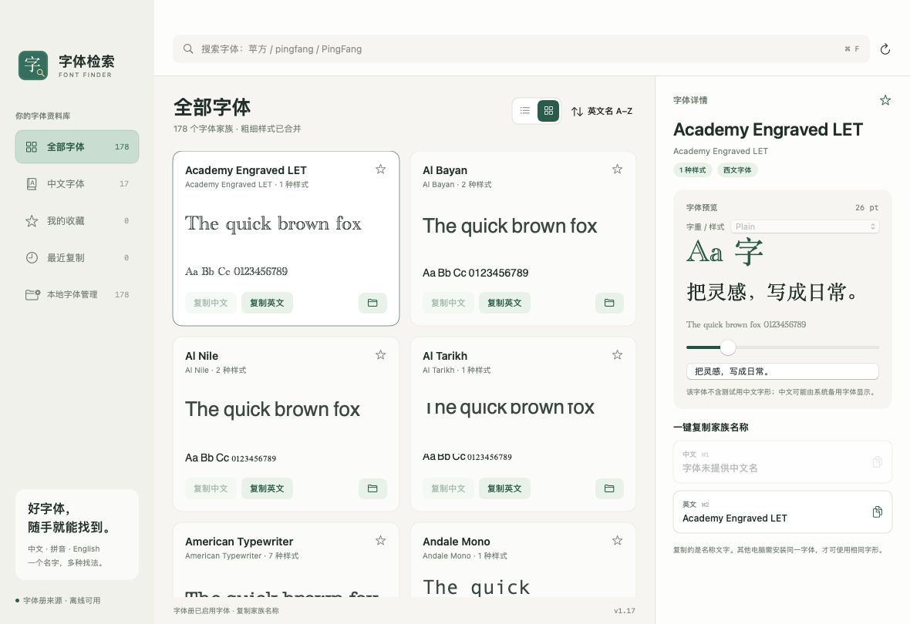

# 字体检索 · Font Finder

好字体，随手就能找到。

字体检索是一款原生 Mac 字体工具，可离线使用。输入中文、拼音、拼音首字母或英文，查找本机已安装并启用的字体，预览不同字重，并复制中文或英文家族名称。

## 下载 v1.17

| 下载文件 | 用途 |
| --- | --- |
| [下载 macOS 安装包（DMG）](https://github.com/sudazz777/ZiTiJianSuo/releases/download/v1.17/FontFinder-macOS-Universal-v1.17.dmg) | Apple 芯片与 Intel Mac，部署目标 macOS 13+ |

## 安装

1. 退出旧版，下载并打开 macOS 通用版 DMG。
2. 将磁盘中的「字体检索.app」拖到旁边的「应用程序」快捷方式；更新时选择替换旧版。
3. 从「应用程序」启动字体检索，然后推出安装磁盘。

应用采用本地 ad-hoc 签名，尚未完成 Developer ID 签名或 Apple 公证。如果首次打开提示无法验证开发者，先尝试打开一次，再前往「系统设置 → 隐私与安全性」，对确认来源的应用选择「仍要打开」。参考 [Apple 官方说明](https://support.apple.com/zh-cn/102445)。

## 功能

- 中文、拼音、首字母、英文及 PostScript 名称搜索。
- 同一家族的字重合并，切换样式、文字及字号进行预览。
- 一键复制中英文家族名称。
- 查看字体文件位置，在访达中定位当前预览字重。
- 全部字体、中文字体、收藏及最近复制分类。
- 本地字体管理：多列字形预览、搜索、多选字体家族，二次确认后批量移到电脑废纸篓；系统字体受保护。
- 英文名称、中文拼音及最近复制等六种排序方式，点击当前排序名称即可选择。
- 每次启动自动检查更新；软件内下载、校验、安装与重启；不进行定时后台检测。
- 本机检索可离线使用，收藏、别名和最近复制保存在本机。更新检查需要联网。

安装包不含字体文件；每台 Mac 显示各自安装的字体。复制的是名称文字，当前版本没有直接连接设计软件写入字体的功能。

## v1.17 版本说明

全部字体、中文字体、我的收藏、最近复制和本地字体管理均提供列表/网格切换，各分类分别记住显示方式。关闭后重新打开会恢复上次所在的分类，以及上次的窗口大小和位置。本地管理的两种布局保留多选、二次确认和废纸篓操作。

侧栏选中项改用柔和的灰绿色底色与深绿色文字、图标，让当前位置清楚且与整体界面协调。移除「编辑中文 / 英文别名」入口及编辑弹窗，字体预览和名称复制继续可用，旧版保存的本机名称数据保留。

v1.14 及后续版本可在软件内选择「更新并重启」安装本版；更早版本需手动安装一次。首次安装仍可拖拽 DMG。

更多软件操作说明见 [使用说明](documentation/user-guide.md)。
