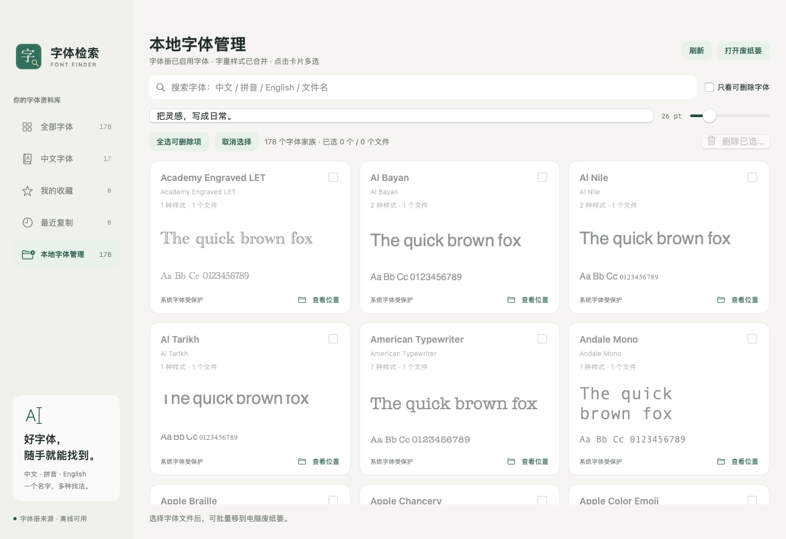

# v1.15 管理工具栏与默认筛选验证

日期：2026-11-04；版本 1.15、构建 16。

- [预发布构建](https://github.com/sudazz777/ZiTiJianSuo/actions/runs/41790486980) 成功，来源 `56b57f8`。本机功能 84 项、更新 46 项、字体管理 29 项、安装 31 项、焦点 13 项、历史 GitHub 模块 61 项全部通过。
- 顶部重新分为标题操作区、搜索/预览面板和批量选择工具栏。输入框统一高度与内边距，筛选使用独立圆角底色，选择统计与删除按钮分开显示，删除按钮的启用状态更明确。
- 管理模型默认仅显示可删除字体，仍可取消勾选查看全部；没有符合条件的字体时提供说明和查看全部入口。既有排序测试明确切回完整列表以比较两页排序，未改变删除权限和二次确认逻辑。
- 已查看原生截图，确认默认筛选勾选、控件对齐和字体预览。CI 截图期间将仓库已有字体复制到临时 UUID 用户字体文件并注册，确认 179 个总家族仅显示其中一个可管理家族；截图后仅删除该测试文件。未操作用户字体。
- DMG 校验、挂载、Finder 布局、复制到 Applications 后的文件完整性、代码签名和 Universal 架构检查通过；实际安装测试包含原子替换、失败回滚与 macOS Launch Services 重新打开。
- 保持仅 GitHub Releases 发布。v1.14 可使用软件内自动更新，v1.13 及更早版本需手动安装一次。实际运行环境为 macOS 14 Apple 芯片，未验证所有系统版本或 Intel 实机；应用仍采用 ad-hoc 签名，未完成 Developer ID 签名或 Apple 公证。

## 正式发布

- [main 构建及发布](https://github.com/sudazz777/ZiTiJianSuo/actions/runs/41790935571) 成功，来源 `0feaa65`；全部检查再次通过。
- [v1.15](https://github.com/sudazz777/ZiTiJianSuo/releases/tag/v1.15) 已公开发布。公开下载与构建产物逐字节一致，稳定更新入口版本为 1.15、构建 16。
- DMG 大小 2,118,850 字节；SHA-256：`69bfeaac11100fea84dff0b1d191680125a26ee5ec4951fd59493dd2ff4d7cff`。
