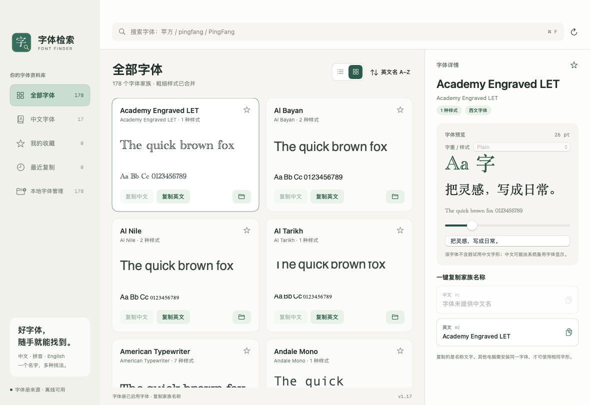

# v1.16 分类高亮与网格显示

日期：2026-11-05；版本 1.16、构建 17。

- 左侧五个分类共用深绿色选中背景，文字、图标为白色，选中数量提高不透明度；未修改其他区域的浅绿色色板。
- 「全部字体」增加列表/网格切换，使用本机偏好设置记住选择。默认保留列表；两种布局读取相同的搜索和排序结果，不修改当前选中字体、收藏或复制行为。其他分类保持原显示方式。
- 网格按可用宽度排列，保留右侧详情及字重预览。卡片可复制中文或英文名称、收藏，以及定位字体文件；西文字体显示英文示例以便比较字形。
- [预发布构建](https://github.com/sudazz777/ZiTiJianSuo/actions/runs/41950910734) 成功，来源 `93da2b5`。本机功能 84 项、更新 46 项、字体管理 29 项、安装 31 项、焦点 13 项、历史 GitHub 模块 61 项全部通过；DMG 挂载、布局、Applications 复制、代码签名和 Universal 架构验证通过。
- 已查看真实应用的网格截图：默认窗口显示两列，右侧详情和卡片操作保留，侧栏选中项清晰可见。切换按钮交互和偏好设置未新增自动化 GUI 测试，使用 SwiftUI 的原生按钮与 AppStorage。
- 实际运行环境为 macOS 14 Apple 芯片；未验证所有 macOS 版本和 Intel 实机。仅在 GitHub Releases 发布，保留拖拽 DMG 和软件内自动更新；应用仍采用 ad-hoc 签名，未完成 Developer ID 签名或 Apple 公证。

## 正式发布

- [main 构建及发布](https://github.com/sudazz777/ZiTiJianSuo/actions/runs/41951512484) 成功，来源 `3592e77`，包含适配最小窗口宽度的网格列宽；全部检查再次通过。
- [v1.16](https://github.com/sudazz777/ZiTiJianSuo/releases/tag/v1.16) 已公开发布。公开下载与构建产物逐字节一致，稳定更新入口版本 1.16、构建 17。
- DMG 大小 2,160,790 字节；SHA-256：`82407337992d6208298d00d8d5cfd0860b1909f3a50b6af6dafb446d73215766`。
