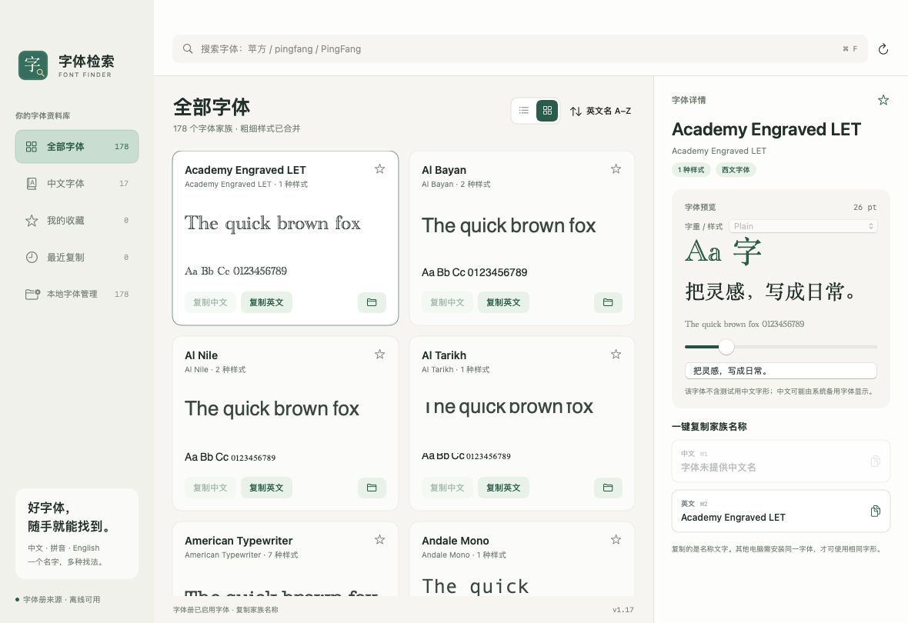

# v1.17 分类布局与窗口记忆

日期：2026-11-05；版本 1.17、构建 18。

- 全部字体、中文字体、收藏、最近复制、本地字体管理共用列表/网格切换控件。五个分类分别保存显示方式；沿用旧版全部字体的偏好键，普通分类默认列表，本地管理默认网格。切换布局不修改查询、排序、当前字体或管理页多选。
- 本地字体管理增加紧凑单列布局，保留选择框、权限保护、预览和文件位置入口；删除仍需确认，文件移到废纸篓。
- 侧栏选中项使用柔和灰绿色底色、深绿色文字图标和淡边框。已查看普通网格与管理列表的真实截图，确认颜色与控件布局。
- 移除别名编辑按钮、弹窗和添加别名提示。旧版已保存的名称记录保留以兼容已有数据，相关底层兼容检查仍保留。
- 分类选择立即写入本机偏好，下次启动恢复；无效记录回退全部字体。窗口在显示前显式恢复原有 Cocoa 保存的尺寸和位置，首次使用居中。截图使用独立模型偏好，窗口不写入真实窗口尺寸。
- [预发布构建](https://github.com/sudazz777/ZiTiJianSuo/actions/runs/41953172355) 成功，来源 `f273eaa`。本机功能 86 项、更新 46 项、字体管理 29 项、安装 31 项、焦点和窗口检查 15 项、历史 GitHub 模块 61 项全部通过。
- 新检查验证重新初始化模型后恢复分类、无效分类回退，以及新建 AppKit 窗口实际读取保存尺寸；截图窗口保持指定尺寸、不覆盖真实窗口配置。布局切换按钮和分栏偏好未新增自动化 GUI 点击测试。
- DMG 挂载、Finder 布局、复制到 Applications 的完整性、签名和 Universal 架构验证通过；实际运行环境为 macOS 14 Apple 芯片，未验证所有系统版本或 Intel 实机。仅向 GitHub Releases 发布；应用仍采用 ad-hoc 签名，未完成 Developer ID 签名和公证。

